# Manual de usuario — Módulo de Estadísticas

| Campo | Valor |
|---|---|
| Sistema | SmartBarber — Panel de administración |
| Módulo | Estadísticas |
| Dirigido a | Administrador de la barbería |
| Requisitos relacionados | RF-67 (dashboard de ingresos), RF-68 (dashboard de cola virtual), RF-70 (indicadores de desempeño), RN-38 |
| Versión | 1.0 — 25-10-2026 |

> **Importante:** en esta versión el módulo muestra **datos de demostración**. Las pantallas y su funcionamiento son los definitivos, pero las cifras son de ejemplo hasta que el servicio de estadísticas del backend esté disponible. La propia pantalla lo indica con un aviso.

---

## 1. ¿Para qué sirve?

El módulo reúne en una sola pantalla la información para tomar decisiones sobre la barbería:

- Cuánto dinero generó la barbería y con qué servicios y barberos.
- Qué tan ocupada estuvo la jornada de cada barbero y en qué horarios hay más demanda.
- Cuáles servicios se piden más.
- Cómo se comportan los clientes: cuántas reservas se atienden, cuántas se cancelan y cuántos clientes no asisten.
- Cuántos espacios libres se recuperaron con la cola virtual y cuánto esperan los clientes.

## 2. Quién puede usarlo

- Solo el usuario con rol **Administrador**. Los barberos y los clientes no ven la opción en el menú y, si intentan abrir la dirección directamente, el sistema los regresa al inicio.
- La barbería debe tener una **suscripción activa**. Sin suscripción, el módulo no está disponible y el sistema lleva al administrador a la pantalla de suscripción.
- Cada administrador ve **únicamente la información de su propia barbería**.

---

## 3. Cómo ingresar

1. Inicia sesión en SmartBarber con tu cuenta de administrador.
2. En el menú lateral, dentro de la sección **Administración**, selecciona **Estadísticas**.

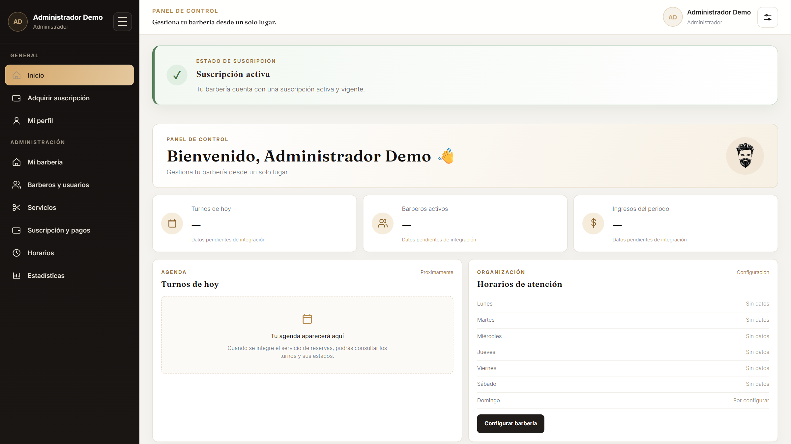

*Figura 1. Panel de administración. La opción **Estadísticas** está al final de la sección Administración.*

Al entrar, la opción queda resaltada en el menú y el módulo muestra por defecto la información del **mes en curso**.

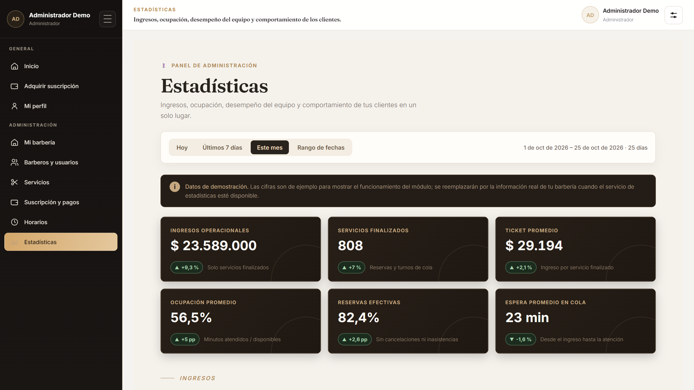

*Figura 2. Vista general del módulo: filtros de periodo, aviso de datos de demostración e indicadores principales.*

---

## 4. Elegir el periodo

Todas las cifras de la pantalla corresponden al periodo seleccionado en la barra de filtros.

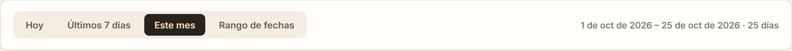

*Figura 3. Filtros de periodo. A la derecha se muestra el rango de fechas que se está consultando.*

| Opción | Qué muestra |
|---|---|
| **Hoy** | Solo el día actual. |
| **Últimos 7 días** | Los últimos siete días, incluido hoy. |
| **Este mes** | Desde el día 1 del mes actual hasta hoy. |
| **Rango de fechas** | Las fechas que tú elijas. |

### 4.1 Consultar un rango de fechas

1. Selecciona **Rango de fechas**.
2. Elige la fecha en **Desde** y la fecha en **Hasta**.
3. Pulsa **Aplicar**.

El sistema revisa las fechas antes de consultar. Si hay un error, muestra un mensaje en rojo debajo de los filtros y conserva en pantalla la información anterior.

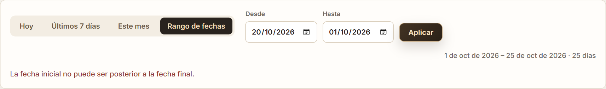

*Figura 4. Ejemplo de validación: la fecha inicial es posterior a la final.*

| Mensaje | Qué hacer |
|---|---|
| *Selecciona una fecha inicial y una fecha final válidas.* | Completa ambas fechas. |
| *La fecha inicial no puede ser posterior a la fecha final.* | Corrige el orden de las fechas. |
| *La fecha final no puede ser posterior a hoy.* | Elige una fecha final igual o anterior a hoy. |
| *El rango no puede superar 366 días.* | Reduce el rango a un año como máximo. |

---

## 5. Indicadores principales

Son seis tarjetas con las cifras clave del periodo.

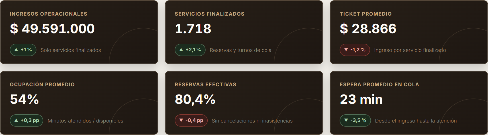

*Figura 5. Indicadores principales del periodo.*

| Indicador | Significado |
|---|---|
| **Ingresos operacionales** | Dinero generado por los servicios **finalizados**. Las reservas canceladas o con inasistencia no suman. |
| **Servicios finalizados** | Cantidad de atenciones completadas, tanto de reservas como de la cola virtual. |
| **Ticket promedio** | Ingreso promedio por cada servicio finalizado. |
| **Ocupación promedio** | Porcentaje de la jornada laboral de los barberos que estuvo ocupado atendiendo. |
| **Reservas efectivas** | Porcentaje de reservas programadas que terminaron en una atención, sin cancelación ni inasistencia. |
| **Espera promedio en cola** | Minutos que, en promedio, esperó un cliente desde que entró a la cola virtual hasta ser atendido. |

**Cómo leer la variación.** Debajo de cada cifra aparece una etiqueta que compara el valor con el **periodo anterior de la misma duración**. Por ejemplo, si consultas los últimos 7 días, se compara con los 7 días previos.

- **Verde:** el cambio es favorable. En la espera en cola, bajar es favorable.
- **Rojo:** el cambio es desfavorable.
- **%** indica cambio relativo; **pp** (puntos porcentuales) se usa para indicadores que ya son porcentajes.
- *Sin periodo previo* significa que no hay datos para comparar.

---

## 6. Ingresos operacionales

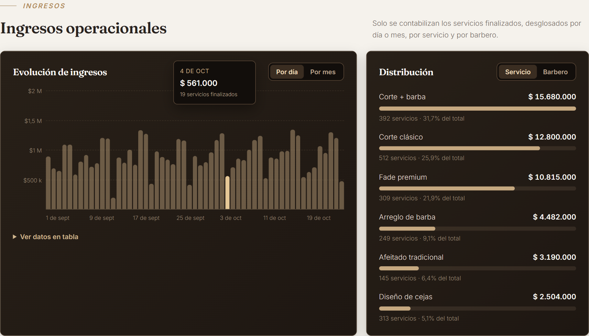

*Figura 6. Evolución de ingresos (izquierda) y distribución por servicio o barbero (derecha).*

**Evolución de ingresos** (gráfico de barras):

- Con los botones **Por día** y **Por mes** cambias cómo se agrupan los ingresos. Para periodos de hasta dos meses el sistema propone *Por día*; para periodos más largos, *Por mes*.
- Al pasar el cursor sobre una barra aparece el detalle: fecha, ingreso y número de servicios finalizados.
- **Ver datos en tabla** despliega los mismos valores en una tabla, útil para leer cifras exactas.

**Distribución** (barras horizontales):

- Con **Servicio** y **Barbero** cambias el desglose.
- Cada fila muestra el ingreso, la cantidad de servicios y el porcentaje que representa del total.

---

## 7. Ocupación y demanda

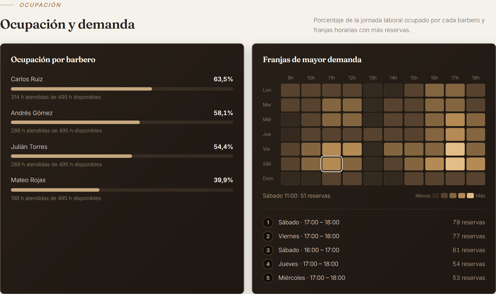

*Figura 7. Ocupación por barbero (izquierda) y mapa de franjas de mayor demanda (derecha).*

**Ocupación por barbero.** Indica qué porcentaje de su jornada estuvo cada barbero atendiendo, junto con las horas atendidas frente a las horas disponibles. Sirve para identificar barberos con poca carga o con sobrecarga.

**Franjas de mayor demanda.** Es un mapa por día de la semana (filas) y hora de inicio (columnas):

- Cuanto **más claro** el recuadro, **más reservas** hubo en esa franja (ver la escala *Menos — Más*).
- Al pasar el cursor, o al recorrer los recuadros con la tecla **Tab**, se muestra el detalle debajo del mapa. Por ejemplo: *Sábado 11:00: 51 reservas*.
- Debajo aparecen las **cinco franjas con más reservas**, ordenadas de mayor a menor.

**Uso sugerido:** reforzar el personal en las franjas pico y programar promociones en las franjas con poca demanda.

---

## 8. Servicios y clientes

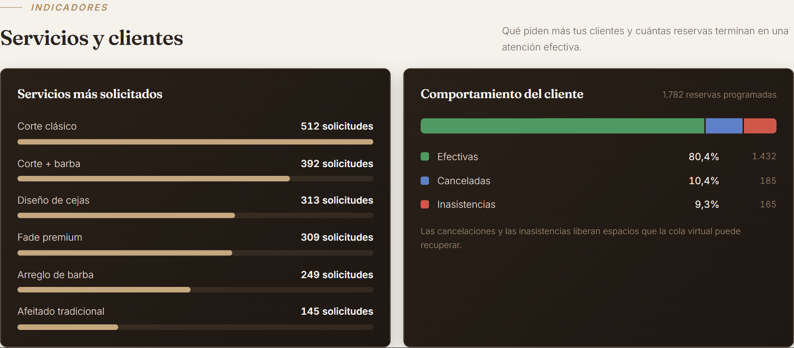

*Figura 8. Servicios más solicitados y comportamiento del cliente.*

**Servicios más solicitados.** Ordena los servicios por número de solicitudes en el periodo.

**Comportamiento del cliente.** Muestra cómo terminaron las reservas programadas:

| Color | Estado | Significado |
|---|---|---|
| Verde | **Efectivas** | El cliente asistió y fue atendido. |
| Azul | **Canceladas** | La reserva se canceló antes de la cita. |
| Rojo | **Inasistencias** | El cliente no se presentó. |

Cada estado se muestra con su porcentaje y su cantidad. Un porcentaje alto de inasistencias es una señal para revisar las políticas de reserva.

---

## 9. Desempeño por barbero

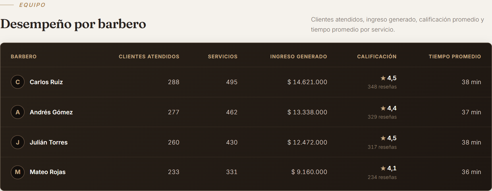

*Figura 9. Desempeño de cada barbero en el periodo.*

| Columna | Significado |
|---|---|
| **Clientes atendidos** | Clientes distintos atendidos por el barbero. |
| **Servicios** | Total de servicios finalizados. Un mismo cliente puede tener varios. |
| **Ingreso generado** | Dinero generado por sus servicios finalizados. |
| **Calificación** | Promedio de las reseñas de los clientes (de 1 a 5) y número de reseñas. |
| **Tiempo promedio** | Duración promedio de sus atenciones, en minutos. |

La tabla está ordenada de mayor a menor ingreso generado.

---

## 10. Cola virtual

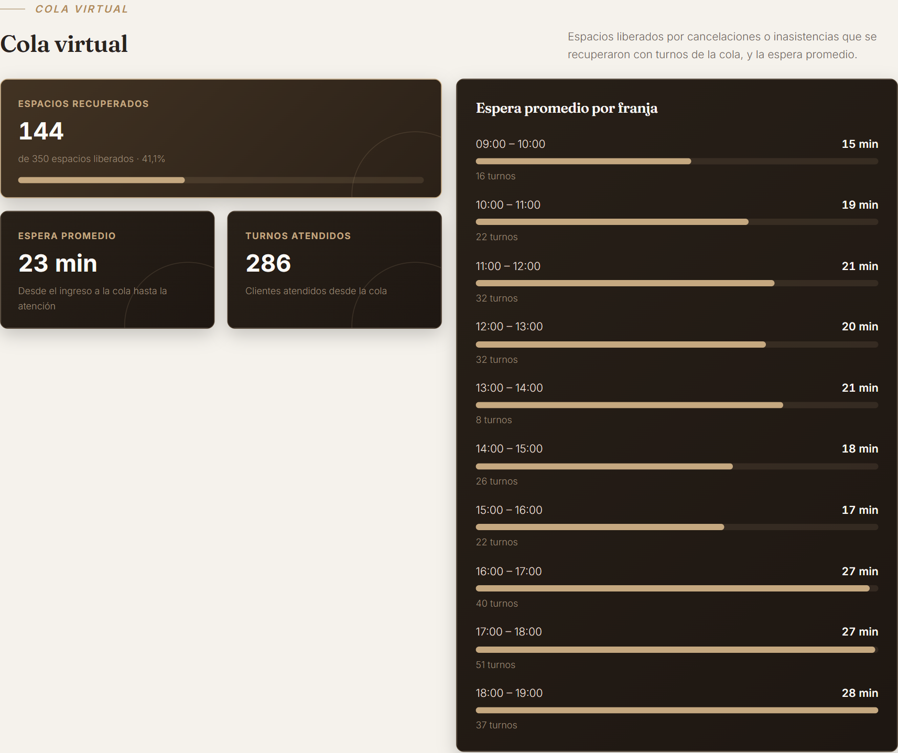

*Figura 10. Métricas de la cola virtual.*

| Indicador | Significado |
|---|---|
| **Espacios recuperados** | Espacios liberados por cancelaciones o inasistencias que se llenaron con clientes de la cola virtual. La barra muestra qué porcentaje de los espacios liberados se recuperó. |
| **Espera promedio** | Minutos promedio desde que el cliente entra a la cola hasta que es atendido. |
| **Turnos atendidos** | Clientes atendidos desde la cola virtual. |
| **Espera promedio por franja** | Espera promedio y número de turnos para cada hora del día. Ayuda a ver en qué horarios la cola se congestiona. |

---

## 11. Uso desde el celular

El módulo se adapta a pantallas pequeñas. El menú lateral se abre con el botón **☰** de la parte superior izquierda, y las tarjetas y gráficos se organizan en una sola columna.

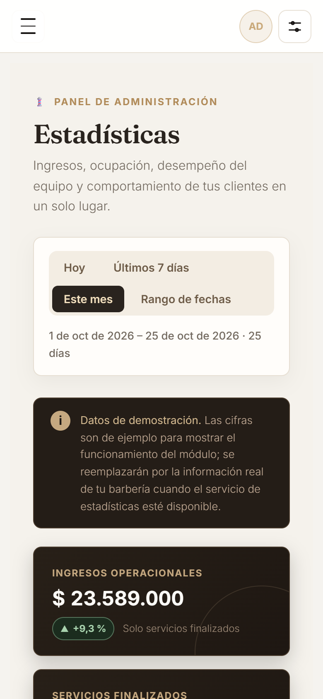

*Figura 11. Vista del módulo en un celular.*

---

## 12. Preguntas frecuentes

**¿Por qué los ingresos no coinciden con el total de reservas?**
Porque solo se cuentan los servicios **finalizados**. Las reservas pendientes, canceladas o con inasistencia no generan ingreso operacional.

**¿Por qué no veo la opción Estadísticas en el menú?**
Puede deberse a una de estas razones: tu usuario no tiene rol de Administrador, o la suscripción de la barbería no está activa. En el segundo caso, revisa el módulo *Suscripción y pagos*.

**¿Puedo ver la información de otra barbería?**
No. Cada administrador consulta únicamente los datos de la barbería asociada a su cuenta.

**La pantalla muestra "No fue posible mostrar las estadísticas".**
Pulsa **Reintentar**. Si el problema continúa, cierra sesión, vuelve a ingresar y, si persiste, comunícate con el soporte de SmartBarber.

**¿Las cifras que veo son reales?**
En esta versión no: son datos de demostración, como indica el aviso en la parte superior del módulo.
