# SmartBarber · Manual de usuario

| Campo | Valor |
| --- | --- |
| Proyecto | Plataforma SaaS para la gestión integral y el análisis operativo de barberías |
| Producto | SmartBarber, producto mínimo viable (PMV) |
| Documento | Manual de usuario |
| Versión | 1.1 |
| Fecha | 25-10-2026 |
| Destinatarios | Administradores, barberos y clientes de las barberías; personal técnico (Apéndice 1) |
| Documentos relacionados | Documento de proyecto de grado; Anexo A, Especificación de requisitos; Anexo B, Arquitectura y modelo de datos; [Manual del módulo de Estadísticas](MANUAL_ESTADISTICAS.md) |

| Versión | Fecha | Descripción |
| --- | --- | --- |
| 1.0 | 25-10-2026 | Primera versión del manual para el PMV. |
| 1.1 | 25-10-2026 | Se incorporan capturas de pantalla de la plataforma, el inicio de sesión con Google, el módulo de Estadísticas y se señalan las funciones que aún no están disponibles. |

---

## Contenido

1. [Presentación](#1-presentación)
2. [Conceptos básicos](#2-conceptos-básicos)
3. [Primeros pasos](#3-primeros-pasos)
4. [Guía del administrador](#4-guía-del-administrador)
5. [Guía del barbero](#5-guía-del-barbero)
6. [Guía del cliente](#6-guía-del-cliente)
7. [Referencia de estados](#7-referencia-de-estados)
8. [Solución de problemas y mensajes frecuentes](#8-solución-de-problemas-y-mensajes-frecuentes)
9. [Preguntas frecuentes](#9-preguntas-frecuentes)
10. [Seguridad y protección de datos personales](#10-seguridad-y-protección-de-datos-personales)
11. [Glosario](#11-glosario)
- [Apéndice 1. Instalación y despliegue](#apéndice-1-instalación-y-despliegue)
- [Apéndice 2. Trazabilidad con los requisitos](#apéndice-2-trazabilidad-con-los-requisitos)
- [Apéndice 3. Índice de figuras](#apéndice-3-índice-de-figuras)

---

## 1. Presentación

SmartBarber es una plataforma web de software como servicio (SaaS) que reúne en un solo lugar la suscripción de la barbería, la configuración del establecimiento, los servicios, los horarios de los barberos, las reservas, la cola virtual y los indicadores del negocio. Este manual explica, paso a paso, cómo usarla según el rol de cada persona: administrador, barbero o cliente.

### 1.1 A quién va dirigido

Los capítulos 2 y 3 son comunes a todos los roles. El capítulo 4 está dirigido al administrador, el 5 al barbero y el 6 al cliente. Los capítulos 7 a 11 sirven como consulta rápida. El Apéndice 1 está dirigido al personal técnico que instala la plataforma, y el Apéndice 2 relaciona cada sección con los requisitos del proyecto.

### 1.2 Alcance

El manual describe el producto mínimo viable (PMV) de la plataforma. Las funciones predictivas con inteligencia artificial, el inventario de productos y las aplicaciones móviles nativas no hacen parte de esta versión.

La plataforma funciona como aplicación web adaptable: se usa desde el navegador del computador, la tableta o el celular, sin instalar nada.

> **Funciones en desarrollo.** Algunas opciones del menú aparecen marcadas como **Próximamente** o **No disponible**: se muestran para que el usuario conozca lo que viene, pero todavía no se pueden usar. En este manual se señalan con la nota **Disponibilidad**.

### 1.3 Convenciones de este manual

- **Negrita** indica un botón, una opción del menú o el nombre de un campo, por ejemplo **Confirmar Reserva**.
- Los pasos numerados se siguen en orden.
- Las notas marcadas con **Importante** describen una regla que la plataforma aplica y que puede impedir una acción.
- Las notas marcadas con **Disponibilidad** indican funciones que aún no están habilitadas en esta versión.
- Los nombres de los estados aparecen tal como se muestran en pantalla: Pendiente, Confirmada, En proceso, Finalizada, Cancelada, No asistió y En espera.
- Las capturas de pantalla usan datos de ejemplo (por ejemplo, «Barbería Demo» o «Administrador Demo»); no corresponden a personas ni establecimientos reales.

### 1.4 Documentos relacionados

| Documento | Qué contiene | Cuándo consultarlo |
| --- | --- | --- |
| Documento de proyecto de grado | Problema, objetivos, metodología, resultados y conclusiones. | Para entender el propósito y el alcance del PMV. |
| Anexo A. Especificación de requisitos | Requisitos funcionales, no funcionales y reglas de negocio con su código (RF, RNF, RN). | Para conocer la regla exacta detrás de una función. El Apéndice 2 relaciona cada sección de este manual con sus requisitos. |
| Anexo B. Arquitectura y modelo de datos | Diagramas de contexto, casos de uso, estados y secuencias. | Para ver cómo se conectan las funciones descritas aquí. |
| [Manual del módulo de Estadísticas](MANUAL_ESTADISTICAS.md) | Explicación detallada de cada indicador y gráfico del tablero. | Para interpretar las cifras del tablero de indicadores (sección 4.9). |

### 1.5 Guía rápida por rol

| Rol | Qué hace en la plataforma | Capítulo |
| --- | --- | --- |
| Administrador | Registra la barbería, adquiere la suscripción, configura el establecimiento, gestiona servicios, barberos y horarios, y consulta los indicadores. | 4 |
| Barbero | Maneja su cola virtual: la abre, llama al siguiente cliente, finaliza turnos y la cierra. | 5 |
| Cliente | Elige una barbería, un barbero, los servicios y un horario libre, y confirma su reserva. | 6 |

| Rol | Primeras acciones | Secciones |
| --- | --- | --- |
| Administrador | Registrar la barbería; adquirir la suscripción; revisar la información de la barbería; cargar servicios, barberos y horarios. | 3.2, 4.1, 4.3, 4.4, 4.5, 4.6 |
| Barbero | Iniciar sesión con la cuenta de Google que vinculó el administrador; abrir la cola virtual. | 3.3, 5.2 |
| Cliente | Crear la cuenta con Google; reservar un turno. | 3.2, 6.1 |

---

## 2. Conceptos básicos

Antes de empezar conviene conocer algunas ideas que aparecen en todas las pantallas. Cada barbería tiene su propia información, separada de la de las demás, y solo opera mientras su suscripción esté activa.

| Concepto | Qué significa |
| --- | --- |
| Barbería | Establecimiento registrado en la plataforma. Sus datos, barberos, servicios, clientes y reservas están aislados de los de otras barberías. |
| Suscripción | Plan pagado que habilita a la barbería. Se activa cuando el pago es aprobado y dura el número de días del plan. |
| Servicio | Corte, barba u otra atención que ofrece la barbería, con precio y duración. Solo los servicios activos se pueden reservar. |
| Reserva | Turno programado con un barbero en una fecha y hora. Su duración es la suma de las duraciones de los servicios elegidos. |
| Cola virtual | Fila de espera digital de un barbero para clientes sin reserva. Atiende por orden de llegada. |
| Inasistencia | Reserva confirmada a la que el cliente no llega dentro del tiempo de tolerancia, sin haberla cancelado. |
| Penalización | Restricción temporal para crear nuevas reservas en una barbería cuando el cliente acumula el máximo de inasistencias definido por ella. No implica cobros. |

### 2.1 Roles y permisos

Cada cuenta tiene un solo rol. El menú lateral y las opciones que aparecen dependen de ese rol: el administrador ve la sección **Administración**, el barbero la sección **Operación** y el cliente la sección **Mi experiencia**. Los casos de uso de cada rol se presentan en las Figuras B.6 a B.8 del Anexo B.

| Función | Administrador | Barbero | Cliente |
| --- | --- | --- | --- |
| Gestionar la suscripción | Sí | No | No |
| Configurar la barbería | Sí | No | No |
| Gestionar servicios, barberos y horarios | Sí | No | No |
| Consultar el tablero de Estadísticas | Sí | No | No |
| Abrir, cerrar y atender la cola virtual | No | Sí | No |
| Crear reservas | No | No | Sí |
| Consultar y actualizar su perfil | Sí | Sí | Sí |

### 2.2 Notificaciones

La plataforma envía un correo electrónico al cliente cuando se crea, confirma o cancela una reserva.

> **Disponibilidad.** Los avisos al barbero, los recordatorios antes de la cita, las notificaciones en el navegador o el celular y el aviso de vencimiento de la suscripción aún no están disponibles. La opción **Notificaciones** del menú del cliente aparece como **Próximamente**.

---

## 3. Primeros pasos

Para usar SmartBarber basta un navegador actualizado, conexión a internet y una cuenta de Google. La cola virtual y el resultado de los pagos se actualizan en tiempo real, por lo que requieren una conexión estable.

### 3.1 Requisitos

- Navegador Chrome, Edge, Firefox o Safari en su versión más reciente.
- Conexión a internet estable.
- Una cuenta de Google propia (Gmail o Google Workspace). SmartBarber usa esa cuenta para identificar a cada usuario.

### 3.2 Página de inicio y creación de la cuenta

La página de inicio presenta la barbería y ofrece, en la parte superior derecha, los botones **Inicio** (iniciar sesión) y **Registro**.

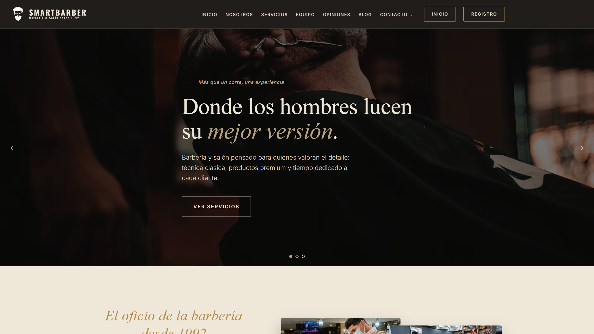

*Figura 1. Página de inicio pública.*

El administrador crea su cuenta al registrar la barbería (sección 4.1). Los barberos los registra el administrador (sección 4.5). El cliente se registra por su cuenta.

**Para registrarse como cliente:**

1. Pulse **Registro** (o, en la pantalla de inicio de sesión, **Registrarme como cliente**).
2. Pulse **Continuar con Google** y elija su cuenta de Google.
3. En **¿Cómo deseas registrarte?**, elija **Cliente**.
4. Complete **Nombre completo**, **Tipo de documento**, **Número de documento** y **Teléfono celular**. El correo se toma de su cuenta de Google y no se puede modificar.
5. Pulse **Crear cuenta de cliente**.

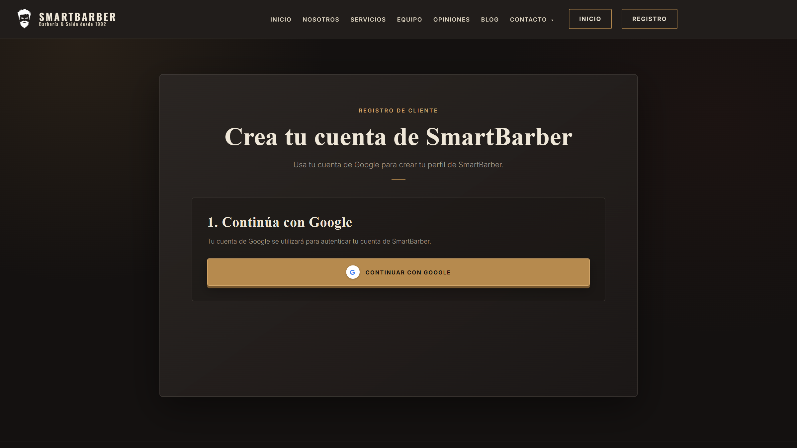

*Figura 2. Registro, paso 1: continuar con Google.*

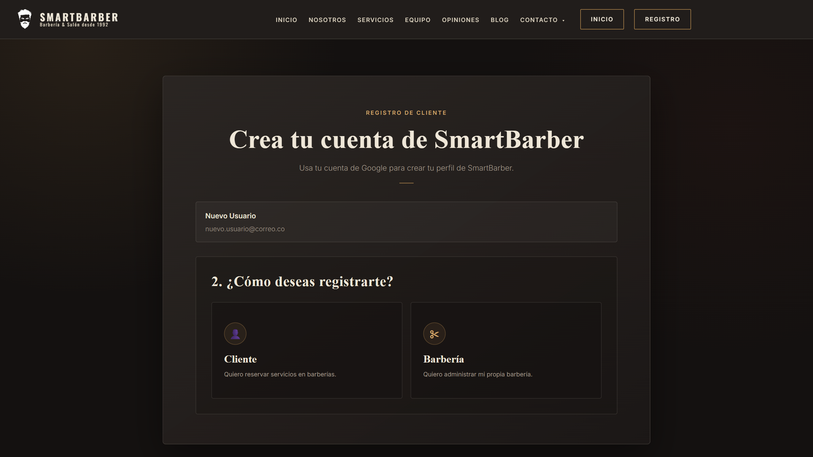

*Figura 3. Registro, paso 2: elegir si la cuenta es de cliente o de barbería.*

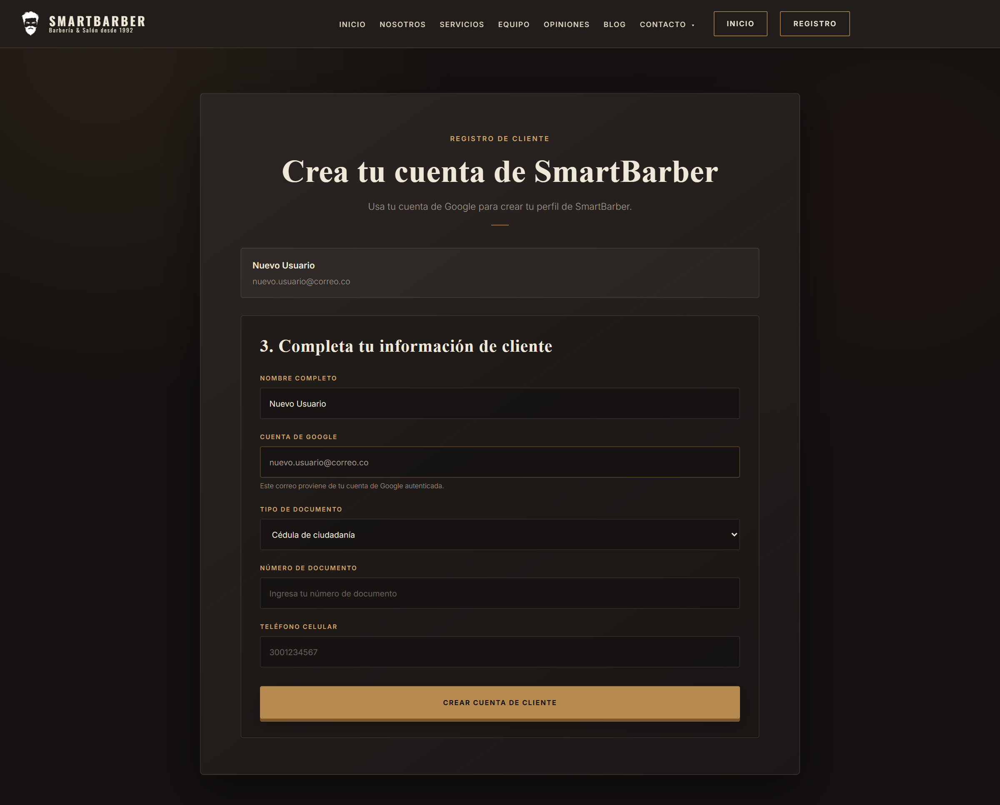

*Figura 4. Registro, paso 3: datos del cliente.*

> **Importante:** el número de documento y la cuenta de Google deben ser únicos. Si ya existen, la plataforma no crea la cuenta y muestra el motivo. El celular debe ser un número colombiano válido de 10 dígitos.

### 3.3 Iniciar sesión

1. Pulse **Inicio** en la parte superior de la página.
2. Pulse **Continuar con Google** y elija la cuenta con la que se registró.
3. La plataforma abre el panel que corresponde a su rol.

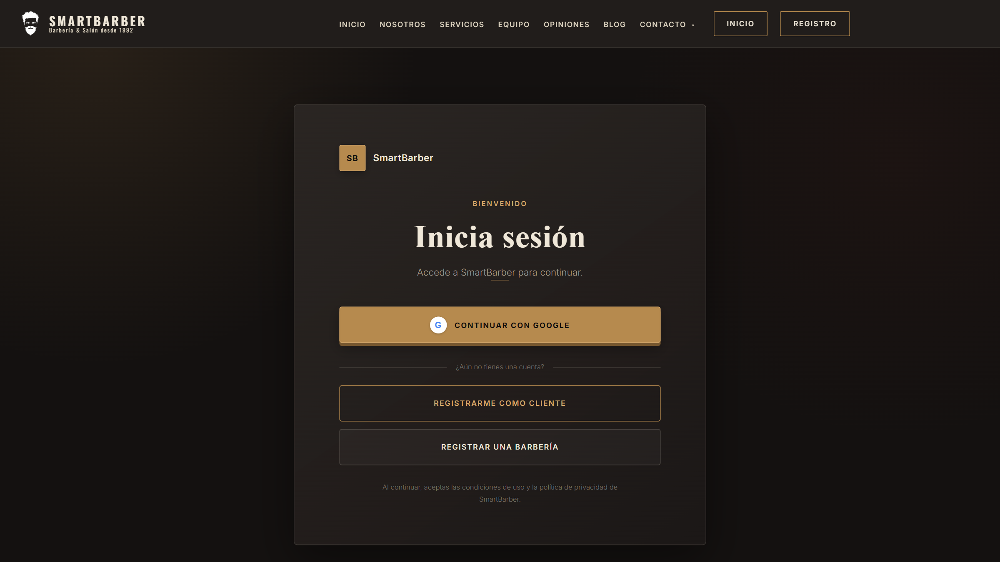

*Figura 5. Inicio de sesión con Google.*

Si la cuenta de Google no está registrada en SmartBarber, la plataforma no abre el panel. En ese caso, regístrese (sección 3.2) o, si es barbero, pida al administrador que lo registre.

### 3.4 Contraseña

SmartBarber no maneja contraseñas propias: el acceso se hace con la cuenta de Google. Para cambiar o recuperar la contraseña, use las opciones de su cuenta de Google (por ejemplo, **¿Olvidaste tu contraseña?** en la pantalla de acceso de Google).

### 3.5 El panel y el menú

Después de iniciar sesión se abre el **Panel de control**. A la izquierda está el menú lateral con las opciones de su rol; en la parte superior se muestran el nombre del módulo actual y, a la derecha, su nombre y rol. El botón **☰** junto a su nombre contrae o expande el menú.

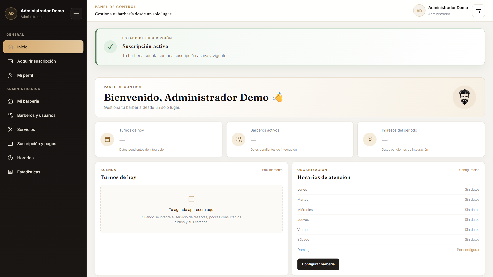

*Figura 6. Panel de control del administrador con el menú lateral.*

En el celular, el menú se abre con el botón **☰** de la esquina superior izquierda.

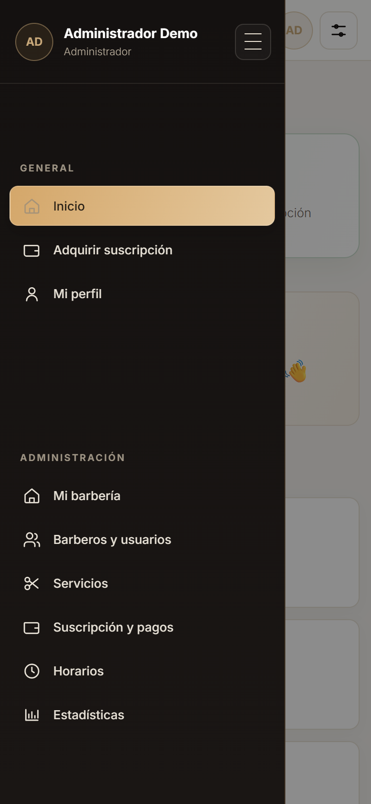

*Figura 7. Menú lateral abierto en un celular.*

### 3.6 Consultar y actualizar el perfil

En **Mi perfil** se consultan los datos de la cuenta: nombre, correo, documento, tipo de documento y teléfono, además del rol y el estado de la cuenta. Si su rol lo permite, pulse **Editar perfil**, modifique los datos y guarde los cambios.

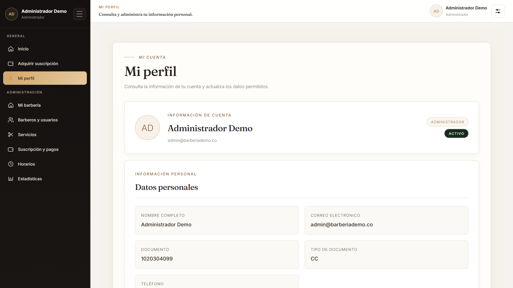

*Figura 8. Pantalla Mi perfil.*

### 3.7 Cerrar sesión

1. Pulse el botón de opciones (icono de controles) en la esquina superior derecha.
2. Pulse **Cerrar sesión**.

La plataforma borra los datos de la sesión del navegador. Use siempre esta opción en equipos compartidos.

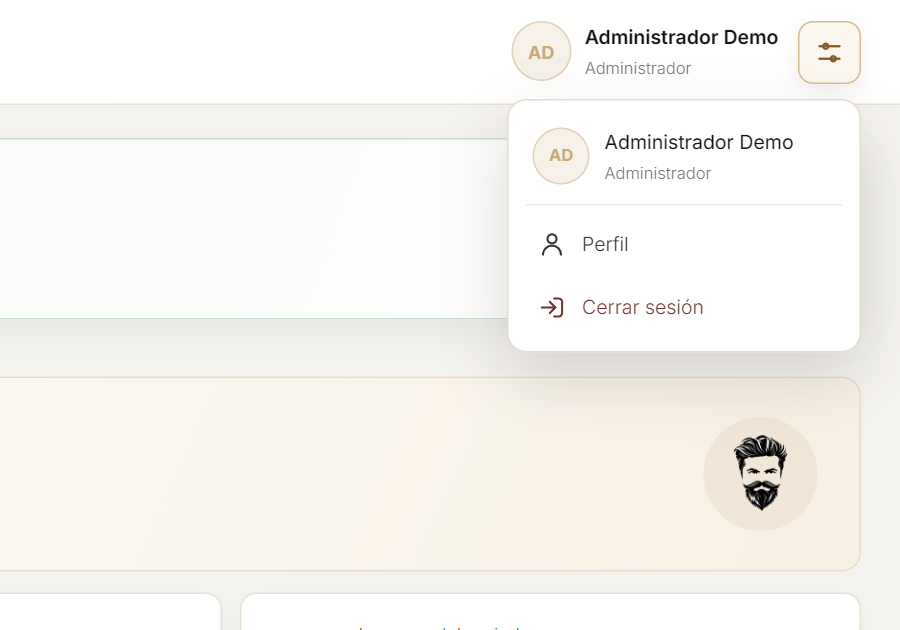

*Figura 9. Menú de usuario con las opciones Perfil y Cerrar sesión.*

---

## 4. Guía del administrador

El administrador deja la barbería lista para operar en cuatro pasos: registrarla y adquirir la suscripción, revisar su información, cargar servicios, barberos y horarios, y luego supervisar los indicadores.

### 4.1 Registrar la barbería

1. En la pantalla de inicio de sesión, pulse **Registrar una barbería** (o en **Registro**, elija **Barbería**).
2. Pulse **Continuar con Google** y elija la cuenta que usará como administrador.
3. **Paso 1, Datos de la barbería:** escriba **Nombre de la barbería**, **Razón social**, **Tipo de documento**, **Número de documento**, **Teléfono**, **Dirección / Ubicación** y **Descripción**. Pulse **Continuar con administrador**.
4. **Paso 2, Administrador:** complete sus datos personales y finalice el registro.

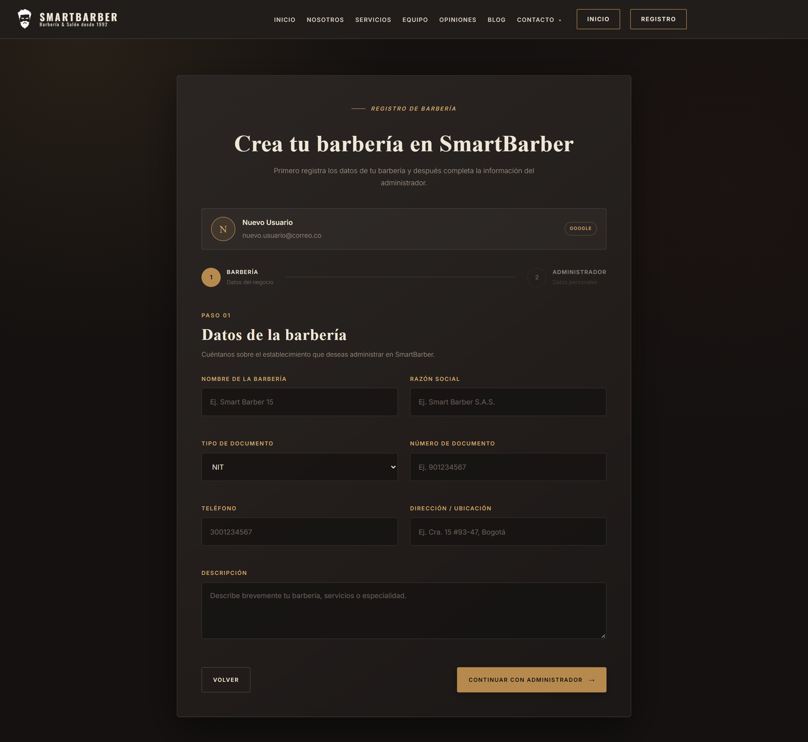

*Figura 10. Registro de la barbería, paso 1: datos del negocio.*

### 4.2 Adquirir la suscripción

Mientras la barbería no tenga un plan activo, el panel muestra el aviso **Tu barbería no tiene un plan activo** y el menú solo ofrece **Inicio**, **Mi perfil** y **Adquirir suscripción**.

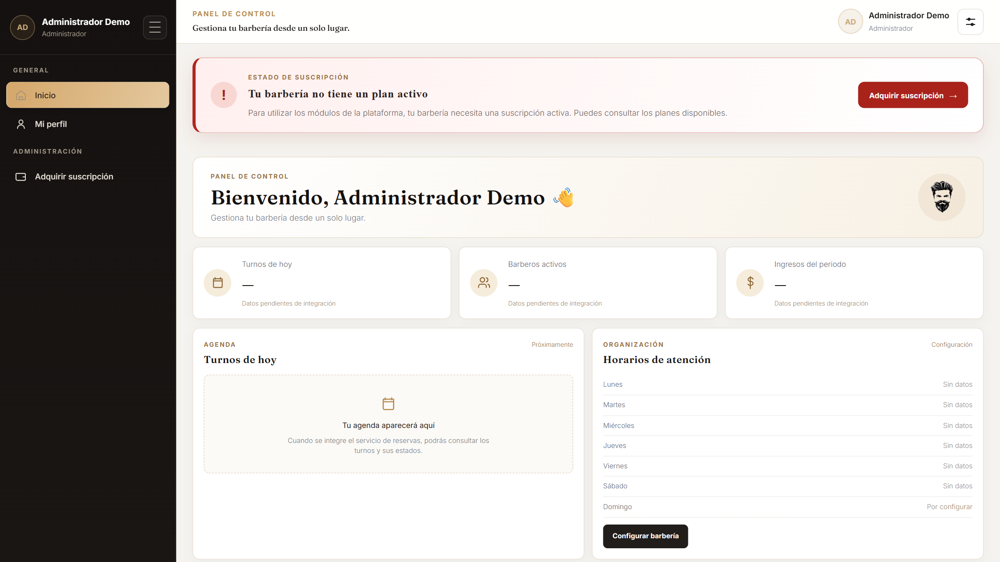

*Figura 11. Panel del administrador sin suscripción: el menú queda limitado.*

1. Pulse **Adquirir suscripción** (en el aviso o en el menú).
2. En **Planes disponibles**, elija un plan. A la derecha se muestran el estado actual y el tipo de renovación.
3. Pulse **Continuar con el plan** y siga las instrucciones del pago.
4. Espere el resultado en la misma pantalla; llega en pocos segundos.

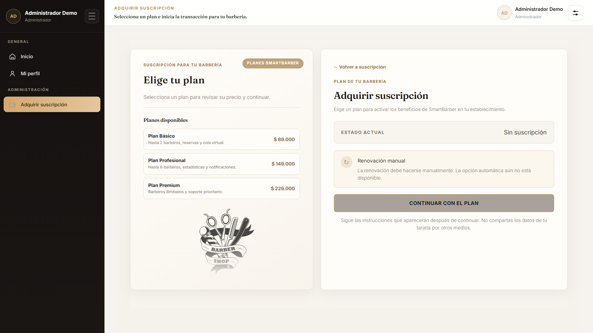

*Figura 12. Adquirir suscripción: catálogo de planes.*

| Resultado | Qué significa | Qué hacer |
| --- | --- | --- |
| Activa | El pago fue aprobado y la suscripción quedó vigente desde ese momento. | Vuelva al panel: el menú completo de administración ya está disponible. |
| Pendiente | La pasarela todavía no responde. | Espere unos segundos y vuelva a consultar. |
| Rechazada | La transacción no fue aprobada. Los datos de la barbería se conservan. | Intente de nuevo. |

> **Importante:** en esta versión la pasarela de pagos es de prueba. Aprueba o rechaza las transacciones para validar el flujo y no procesa dinero real. El recorrido del pago se detalla en las Figuras B.20 y B.21 del Anexo B.

### 4.3 Panel de inicio

Con la suscripción activa, el panel muestra el aviso **Suscripción activa**, un saludo, accesos a los módulos disponibles y tarjetas de resumen. El menú lateral habilita la sección **Administración**: **Mi barbería**, **Barberos y usuarios**, **Servicios**, **Suscripción y pagos**, **Horarios** y **Estadísticas**.

Ver la Figura 6. En la tarjeta **Resumen semanal**, el enlace **Ver estadísticas →** abre el tablero de indicadores (sección 4.9).

> **Disponibilidad.** Las tarjetas **Turnos de hoy**, **Barberos activos** e **Ingresos del periodo** del panel muestran «Datos pendientes de integración», y la agenda del día aparece como **Próximamente**.

### 4.4 Mi barbería

En **Mi barbería** se consulta y se modifica la información general del establecimiento: nombre, razón social, documento, teléfono, ubicación y descripción.

1. Entre a **Mi barbería**.
2. Pulse **Consultar** para ver el detalle o **Editar información** para modificarlo.
3. Guarde los cambios.

En **Días no laborables & festivos** se registran fechas de cierre: elija la fecha, escriba el motivo y pulse **Agregar**.

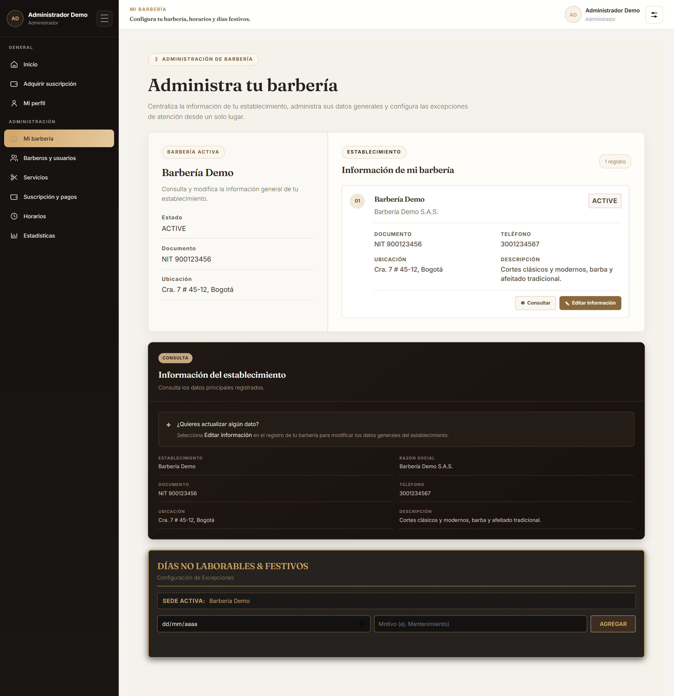

*Figura 13. Mi barbería: información del establecimiento y días no laborables.*

> **Disponibilidad.** La carga del logo, las políticas de reserva y cancelación, la política de penalización y los canales de contacto todavía no se pueden configurar desde el panel. El registro de días festivos depende de un servicio que aún no está habilitado en el servidor.

### 4.5 Gestionar servicios

1. Entre a **Servicios**.
2. En **Crear Nuevo Servicio**, escriba **Nombre del servicio**, **Descripción**, **Duración (minutos)** y **Precio ($)**.
3. Si el servicio tiene un precio promocional, marque **¿Servicio en oferta especial?** y escriba el precio especial.
4. Pulse **Crear servicio**.

En **Catálogo de Servicios** aparecen los servicios registrados. Cada uno tiene los botones **Modificar**, **Desactivar** y **Eliminar**; los servicios en promoción muestran la etiqueta **OFERTA**.

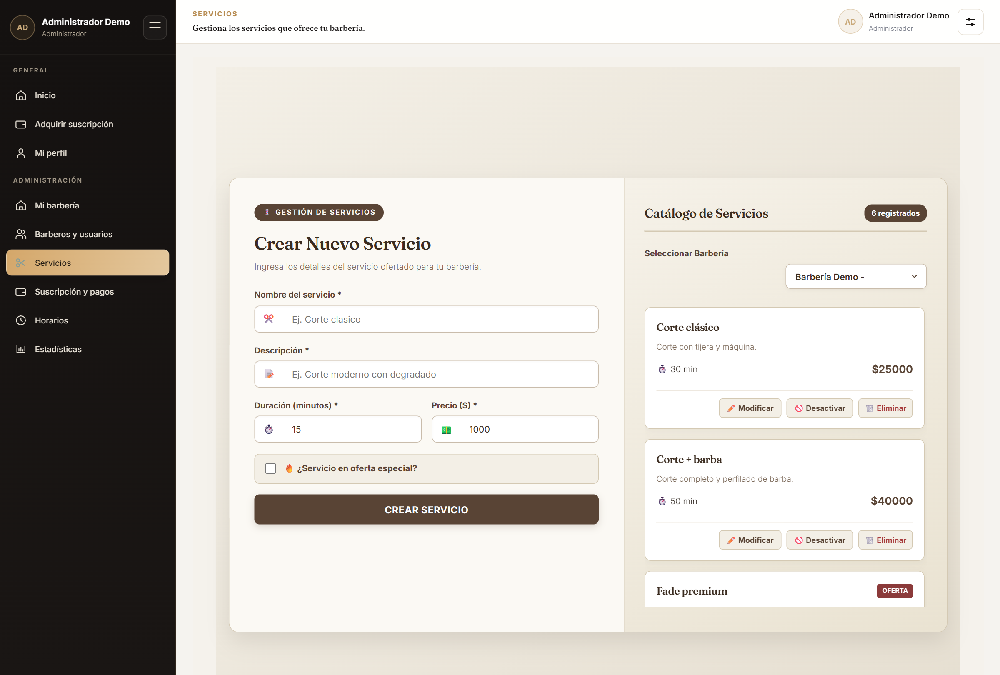

*Figura 14. Servicios: formulario de creación y catálogo.*

> **Importante:** un servicio desactivado deja de mostrarse a los clientes, pero conserva su historial. Se recomienda desactivar en lugar de eliminar un servicio con reservas.

### 4.6 Barberos y usuarios

**Para registrar un barbero:**

1. Entre a **Barberos y usuarios** y pulse **Crear barbero**.
2. Pulse **Vincular cuenta de Google** y elija la cuenta con la que el barbero entrará a SmartBarber. El **Correo de acceso** se toma de esa cuenta.
3. Escriba **Nombre completo**, **Tipo de documento**, **Número de documento** y **Celular**.
4. Marque al menos una **Especialidad**: Cortes, Barba, Colorimetría o Tratamientos capilares.
5. Pulse **Crear barbero**. El barbero ya puede iniciar sesión con la cuenta de Google vinculada.

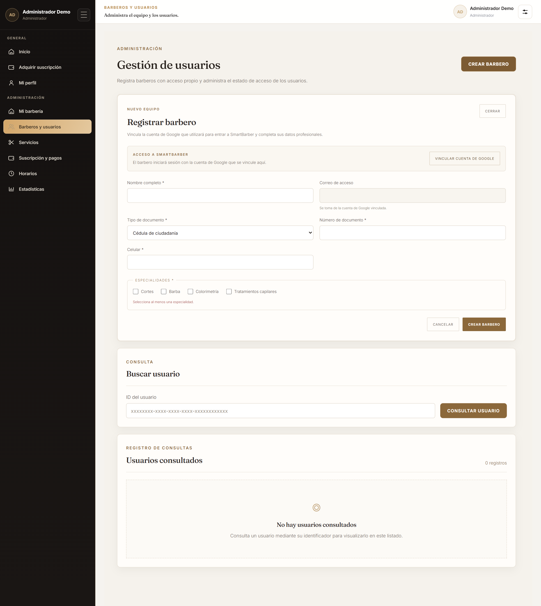

*Figura 15. Registrar barbero.*

**Para consultar o bloquear un usuario:**

1. En **Buscar usuario**, escriba el **ID del usuario** y pulse **Consultar usuario**.
2. En **Estado de acceso** se muestran el identificador, el estado y la fecha de registro.
3. Para impedir el acceso, pulse **Bloquear usuario** y escriba el motivo.

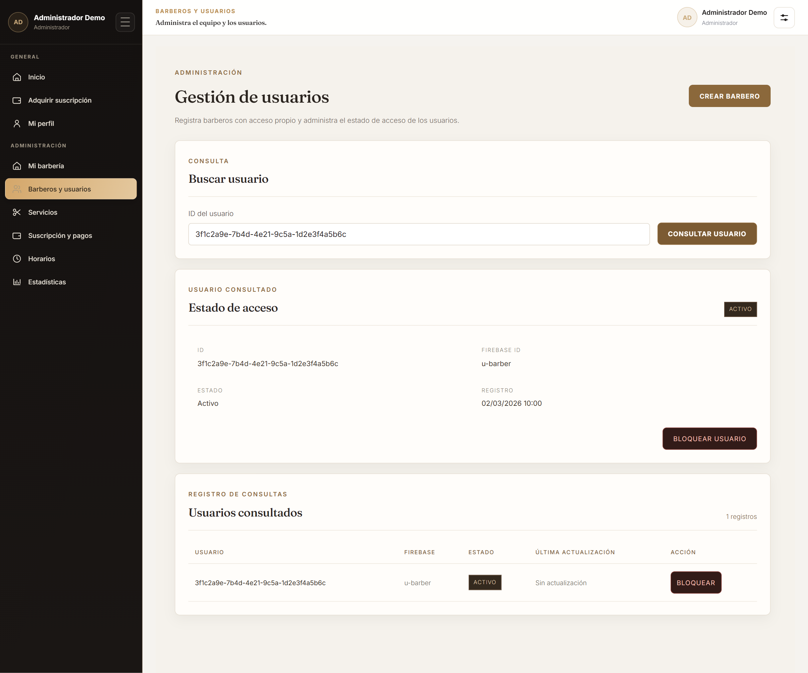

*Figura 16. Gestión de usuarios: consulta y estado de acceso.*

> **Disponibilidad.** En esta versión el bloqueo se registra en la pantalla, pero el servidor todavía no lo aplica al iniciar sesión ni guarda el motivo. No hay un listado completo de usuarios: la búsqueda se hace por identificador.

### 4.7 Horarios de los barberos

1. Entre a **Horarios**.
2. En **Equipo de trabajo**, seleccione un barbero.
3. En **Jornada laboral**, defina la hora de **Inicio** y de **Finalización**.
4. En **Pausa de almuerzo**, defina el periodo en que el barbero no estará disponible.
5. Si el barbero está de vacaciones, active **Empleado en vacaciones**.
6. Pulse **Guardar horario** (o **Actualizar horario**, si ya tenía uno).

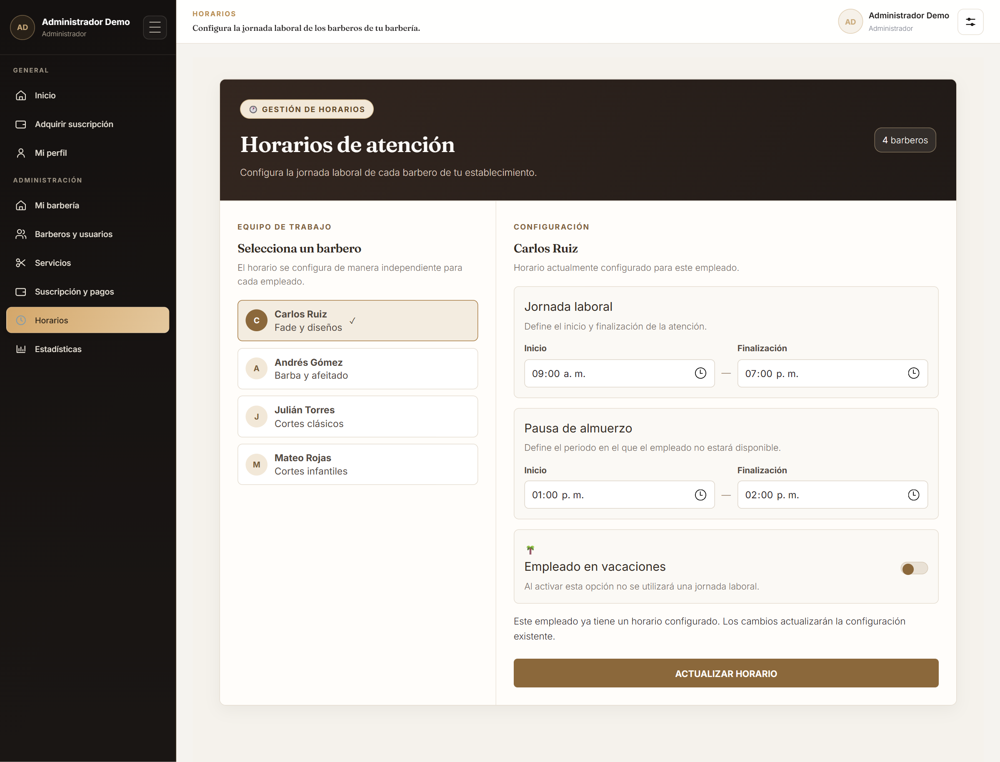

*Figura 17. Horarios: jornada laboral, almuerzo y vacaciones por barbero.*

El horario se usa al reservar: los clientes solo ven como disponibles las horas dentro de la jornada, fuera del almuerzo y libres de otras reservas. Un barbero en vacaciones aparece como no disponible.

> **Disponibilidad.** El horario es el mismo para todos los días; todavía no se puede definir un horario distinto por día de la semana.

### 4.8 Agenda, reservas e inasistencias

> **Disponibilidad.** La agenda de toda la barbería (vista diaria, semanal y mensual), la creación de reservas desde recepción, la reprogramación, el registro de inasistencias y las penalizaciones automáticas aún no tienen pantalla. Las reglas que aplicarán se describen a continuación para referencia.

Cuando estén disponibles, al seleccionar una reserva se mostrarán las acciones que permite su estado:

| Acción | Cuándo está disponible | Resultado |
| --- | --- | --- |
| Confirmar llegada | Reserva Pendiente o Confirmada, cuando el cliente llega | Registra la asistencia. |
| Iniciar servicio | Reserva Confirmada | Pasa a En proceso. |
| Finalizar | Reserva En proceso | Pasa a Finalizada y suma al ingreso operacional. |
| Reprogramar | Reserva que no ha iniciado | Cambia fecha y hora si el nuevo horario está libre. |
| Cancelar con motivo | Reserva que no ha iniciado | Pasa a Cancelada; el motivo es obligatorio y se notifica al cliente. |
| Marcar No asistió | Reserva Confirmada cuyo tiempo de tolerancia venció | Registra la inasistencia. |

Cuando una reserva quede como No asistió, se sumará una inasistencia al historial del cliente en esa barbería. Si el cliente alcanza el máximo definido en la política dentro del periodo configurado, quedará restringido para crear nuevas reservas en esa barbería durante los días establecidos. Las inasistencias de una barbería no afectan al cliente en otras barberías. El proceso completo aparece en la Figura B.18 del Anexo B.

### 4.9 Tablero de indicadores (Estadísticas)

En **Estadísticas** el administrador consulta los indicadores de su barbería para el periodo que elija: **Hoy**, **Últimos 7 días**, **Este mes** o **Rango de fechas**.

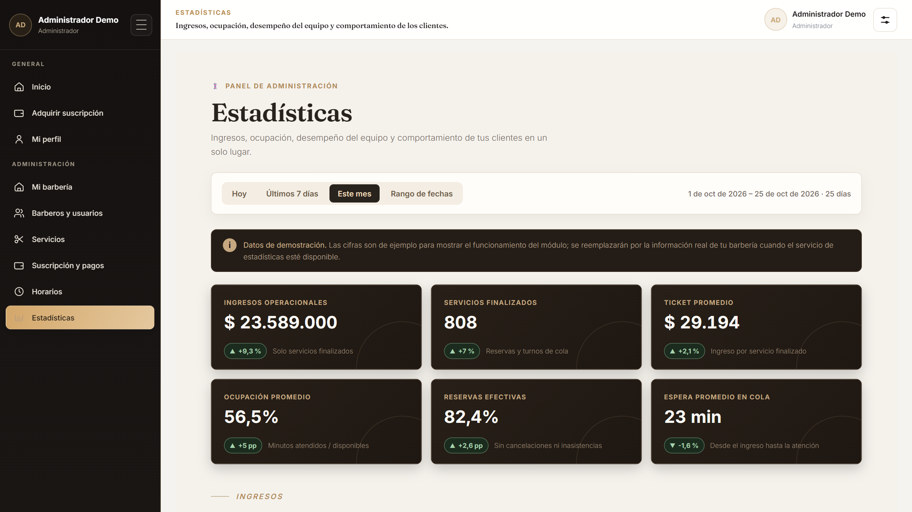

*Figura 18. Estadísticas: filtros de periodo e indicadores principales.*

| Indicador | Cómo se calcula |
| --- | --- |
| Ingresos operacionales | Suma del precio de los servicios efectivamente finalizados. |
| Ocupación | Minutos atendidos frente a los minutos disponibles de la jornada de los barberos. |
| Franjas de mayor demanda | Reservas por día de la semana y hora de inicio. |
| Servicios más solicitados | Número de veces que se solicitó cada servicio. |
| Desempeño por barbero | Clientes atendidos, ingreso generado, calificación y tiempo promedio. |
| Comportamiento del cliente | Reservas efectivas frente a canceladas e inasistencias. |
| Cola virtual | Espacios recuperados, espera promedio y turnos atendidos. |

Cada indicador se compara con el periodo anterior de la misma duración. Al pasar el cursor sobre los gráficos aparece el detalle, y **Ver datos en tabla** muestra los valores exactos.

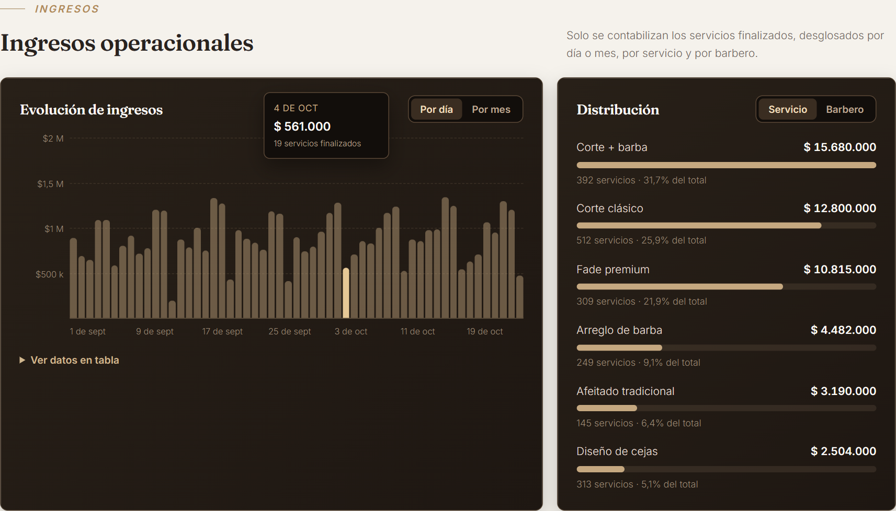

*Figura 19. Estadísticas: evolución y distribución de los ingresos.*

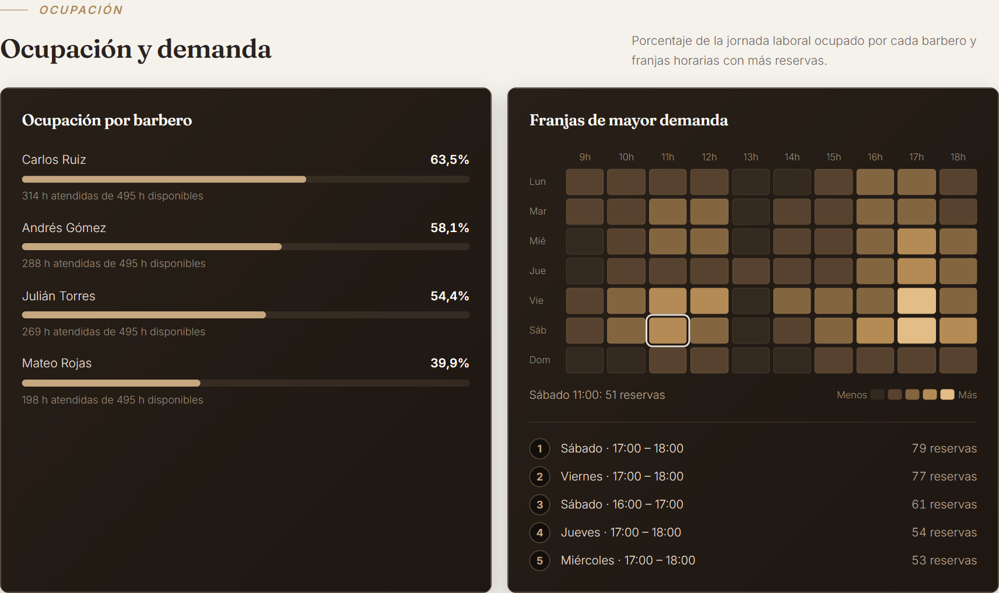

*Figura 20. Estadísticas: ocupación por barbero y franjas de mayor demanda.*

El significado de cada tarjeta y gráfico se explica en detalle en el [Manual del módulo de Estadísticas](MANUAL_ESTADISTICAS.md).

> **Importante:** los indicadores consideran solo la información de su barbería. No reemplazan la contabilidad: no incluyen costos ni gastos.

> **Disponibilidad.** En esta versión el tablero muestra **datos de demostración**, como indica el aviso de la propia pantalla. Las cifras se reemplazarán por la información real cuando el servicio de estadísticas esté disponible.

### 4.10 Suscripción y pagos

En **Suscripción y pagos** se consultan la barbería asociada, el estado de la suscripción, el plan actual, el valor registrado, la duración y la fecha de vigencia.

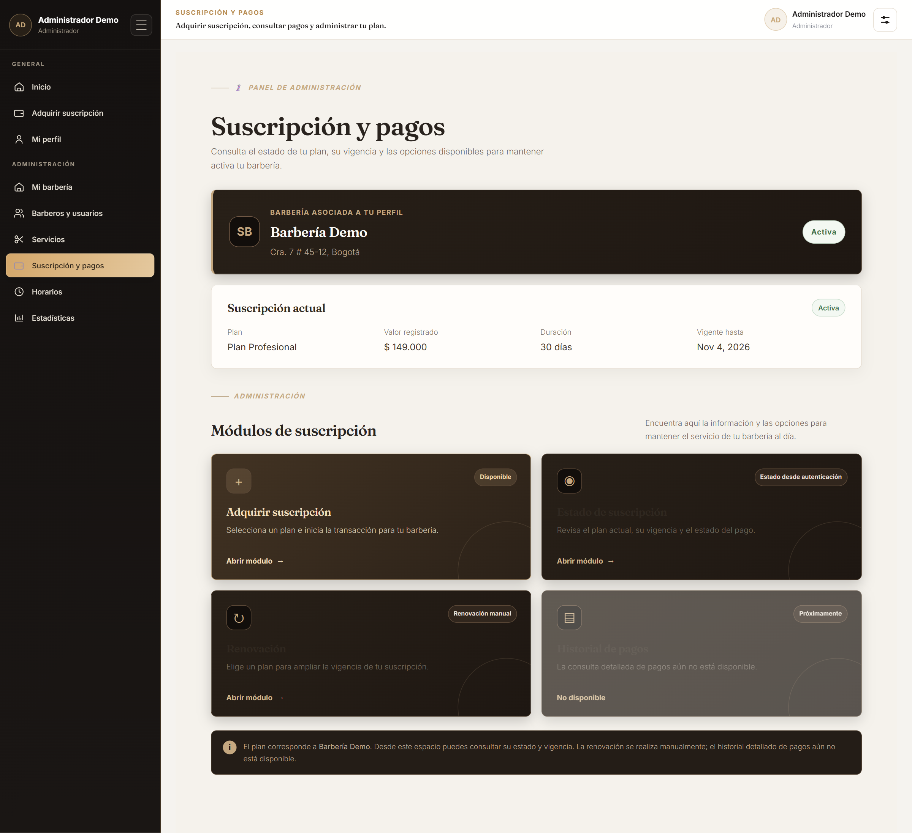

*Figura 21. Suscripción y pagos: plan vigente y módulos de suscripción.*

Desde **Módulos de suscripción** se accede a:

- **Adquirir suscripción:** seleccionar un plan e iniciar el pago (sección 4.2).
- **Estado de suscripción:** revisar el plan actual, su vigencia y el estado del pago.
- **Renovación:** elegir un plan para ampliar la vigencia. Si la suscripción actual sigue vigente, el nuevo periodo queda **Aprobado** y comienza cuando venza el actual.

> **Importante:** si la suscripción vence, la barbería no puede usar los módulos de administración hasta renovarla.

> **Disponibilidad.** El **Historial de pagos** aparece como **No disponible**. La renovación automática, el cambio de plan y la cancelación de la suscripción aún no están habilitados; la renovación se hace manualmente.

---

## 5. Guía del barbero

El barbero trabaja desde su panel, que reúne su perfil y su cola virtual. Su cuenta la crea el administrador (sección 4.6); el primer ingreso se hace con la cuenta de Google que el administrador vinculó.

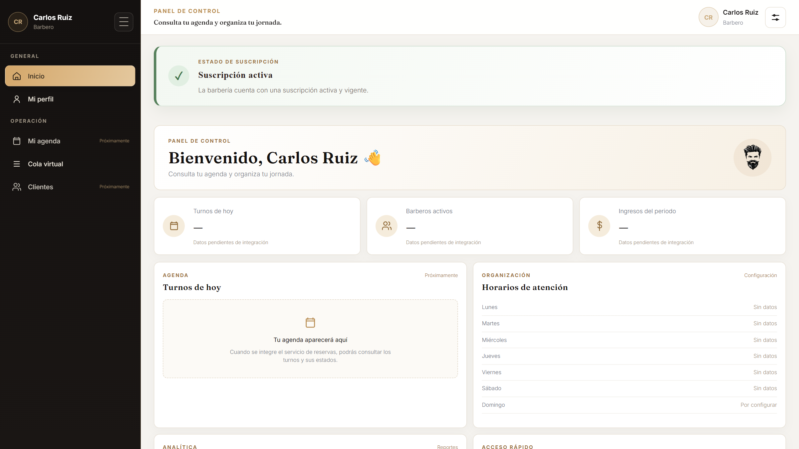

*Figura 22. Panel de control del barbero.*

### 5.1 Consultar la agenda

> **Disponibilidad.** **Mi agenda** y **Clientes** aparecen como **Próximamente** en el menú del barbero. Cuando estén disponibles, mostrarán los próximos turnos con hora, cliente, servicios, duración y estado.

### 5.2 Manejar la cola virtual

Entre a **Cola virtual**. La pantalla muestra el **Estado de la cola**, los **Clientes en espera**, el **Turno actual** y la lista **En espera**.

1. Si la cola está cerrada, pulse **Habilitar cola virtual** (o **Abrir cola**) para empezar a recibir clientes. Solo puede tener una cola abierta.
2. Los clientes que se unen aparecen en orden de llegada en **En espera**, con su número de reserva, duración y estado.
3. Cuando quede libre, pulse **Llamar siguiente**. El primer cliente en espera pasa a **Turno actual**, con el estado **En atención**.
4. Al terminar, pulse **Finalizar turno**.
5. Para dejar de recibir clientes nuevos, pulse **Cerrar cola**. Los clientes que ya estaban en espera se siguen atendiendo.
6. Pulse **Actualizar** para refrescar el estado si lo necesita.

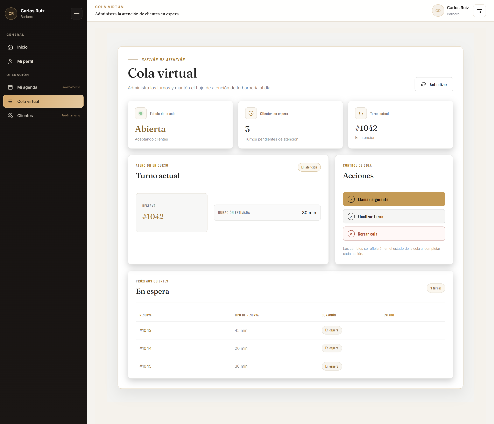

*Figura 23. Cola virtual: estado, turno actual, acciones y clientes en espera.*

> **Importante:** se atiende un solo turno de la cola a la vez, y solo se puede finalizar el turno en atención. No se puede llamar al siguiente cliente mientras haya un turno en atención.

### 5.3 Atender una reserva programada

> **Disponibilidad.** Los botones para registrar la llegada del cliente, iniciar y finalizar una reserva programada, y marcar **No asistió**, aún no tienen pantalla. Hoy solo se gestionan los turnos de la cola virtual (sección 5.2).

### 5.4 Horario y vacaciones

El horario laboral, el almuerzo y las vacaciones del barbero los configura el administrador en **Horarios** (sección 4.7). Si necesita un cambio o registrar una ausencia, comuníquese con el administrador.

### 5.5 Indicadores y reseñas

> **Disponibilidad.** El panel con indicadores propios del barbero y las reseñas de sus clientes aún no está disponible. El administrador puede consultar el desempeño de cada barbero en **Estadísticas** (sección 4.9).

---

## 6. Guía del cliente

El cliente reserva un turno con anticipación desde **Mis reservas**. Todo se hace desde el celular o el computador, con la sesión iniciada.

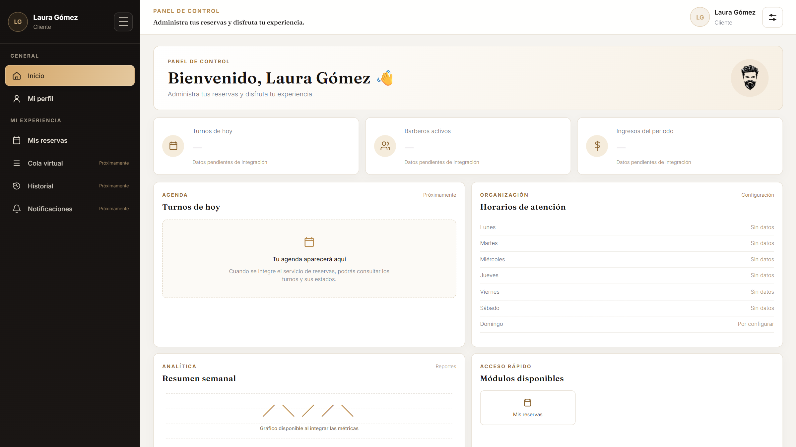

*Figura 24. Panel de control del cliente.*

### 6.1 Reservar un turno

Al entrar, la pantalla propone una selección inicial: la primera sede, el primer barbero, todos los servicios marcados y la fecha de hoy. Ajuste cada elección antes de confirmar.

1. En el menú, entre a **Mis reservas**. Se abre la pantalla **Agendar Cita**.
2. En **Sede Barbería**, elija la barbería.
3. Elija un barbero. Cada tarjeta muestra su nombre, su especialidad y si está libre.
4. En **Servicios Disponibles**, deje marcados solo los servicios que desea. Cada servicio muestra su precio y su duración; si tiene oferta, aparece el precio anterior tachado.
5. En el calendario, elija la fecha. Use **<** y **>** para cambiar de mes.
6. En **Horarios Disponibles**, elija una hora libre. Las horas no disponibles aparecen deshabilitadas e indican el motivo: **Ocupado**, **Almuerzo**, **Sin tiempo** o **Pasado**.
7. Revise el resumen: servicios, duración total y **Total** a pagar.
8. Pulse **Confirmar Reserva**.

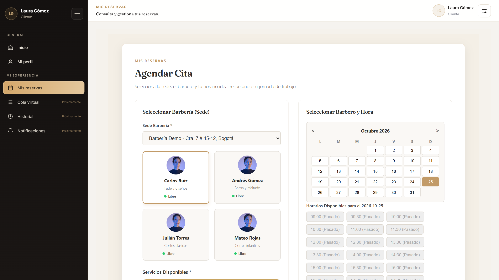

*Figura 25. Agendar Cita: pantalla inicial con la selección propuesta (las horas ya transcurridas del día aparecen como Pasado).*

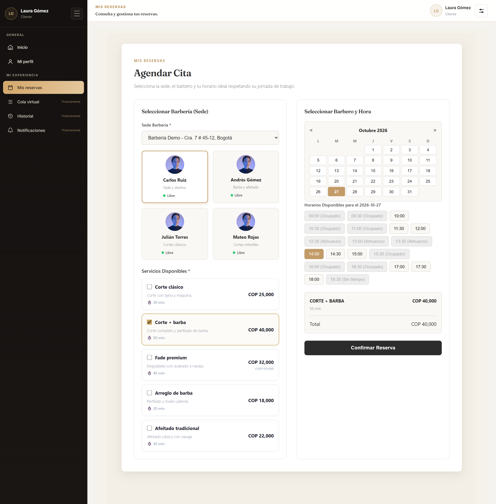

*Figura 26. Agendar Cita: barbería, barbero, servicio, fecha y hora seleccionados.*

La reserva queda en estado **Pendiente** y llega un correo de confirmación. La plataforma rechaza la reserva si el horario ya está ocupado o si usted ya tiene otra reserva a esa misma hora. Las validaciones se muestran en la Figura B.22 del Anexo B.

> **Importante:** el horario elegido debe alcanzar para todos los servicios marcados. Si elige varios servicios, la duración total aumenta y algunas horas pueden aparecer como **Ocupado** o **Sin tiempo**. Debe mantener al menos un servicio seleccionado.

### 6.2 Reprogramar o cancelar

> **Disponibilidad.** La reprogramación y la cancelación desde la pantalla del cliente aún no están disponibles. Si necesita cambiar o cancelar una reserva, comuníquese con la barbería.

Cuando estén disponibles, se aplicará la anticipación mínima que define la barbería; por defecto, 24 horas antes de la cita.

### 6.3 Unirse a la cola virtual

> **Disponibilidad.** La opción **Cola virtual** del menú del cliente aparece como **Próximamente**. Cuando esté disponible, el cliente podrá elegir la barbería y el barbero, unirse a su cola y ver su posición y el tiempo estimado de espera, actualizados en tiempo real.

### 6.4 Historial e inasistencias

> **Disponibilidad.** La opción **Historial** aparece como **Próximamente**. Cuando esté disponible, reunirá las reservas anteriores con filtros por estado y mostrará las inasistencias y restricciones vigentes.

### 6.5 Calificar un servicio

> **Disponibilidad.** La calificación de servicios desde la pantalla del cliente aún no está disponible.

### 6.6 Preferencias de notificación

> **Disponibilidad.** La opción **Notificaciones** aparece como **Próximamente**. Hoy la plataforma envía por correo los avisos de creación, confirmación y cancelación de las reservas.

---

## 7. Referencia de estados

Cada reserva, suscripción y cola pasa por estados fijos, y las acciones disponibles en pantalla dependen del estado actual.

### 7.1 Estados de la reserva

| Estado | Significado |
| --- | --- |
| Pendiente | Reserva creada, a la espera de confirmación. |
| Confirmada | Reserva aceptada; el turno está apartado. |
| En espera | Turno de la cola virtual a la espera de ser atendido. |
| En proceso | El barbero está atendiendo al cliente. |
| Finalizada | Servicio terminado; suma al ingreso operacional. |
| Cancelada | Turno liberado por el cliente o por el administrador. |
| No asistió | El cliente no llegó dentro del tiempo de tolerancia. |

Una reserva solo se cancela mientras no haya iniciado, y una reserva En proceso solo puede finalizarse. Finalizada, Cancelada y No asistió son estados finales. Este ciclo corresponde a la Figura B.15 del Anexo B y a la regla RN-14.

### 7.2 Estados de la suscripción

| Estado | Significado |
| --- | --- |
| Pendiente | Compra o renovación registrada, a la espera del resultado del pago. |
| Activa | Pago aprobado; la barbería opera hasta la fecha de vencimiento. |
| Aprobada | Renovación pagada que empieza cuando venza el periodo actual. |
| Rechazada | El pago no fue aprobado; no hay cambios en la barbería. |
| Vencida | Llegó la fecha de vencimiento; la barbería no puede operar hasta renovar. |
| Sin suscripción | La barbería nunca ha adquirido un plan. |

### 7.3 Estados de la cola virtual

| Estado | Significado |
| --- | --- |
| Cerrada | El barbero no recibe clientes nuevos. |
| Abierta, sin clientes | El barbero acepta clientes y nadie está en espera. |
| Abierta, con clientes en espera | Hay clientes en fila, atendidos por orden de llegada. |
| En atención | El barbero atiende un turno de la cola; solo uno a la vez. |

---

## 8. Solución de problemas y mensajes frecuentes

La mayoría de los mensajes de la plataforma indican una regla de la barbería, no una falla. La tabla resume qué significa cada uno y cómo resolverlo.

| Mensaje o situación | Causa | Qué hacer |
| --- | --- | --- |
| La plataforma no abre el panel después de elegir la cuenta de Google | La cuenta de Google no está registrada en SmartBarber. | Regístrese (sección 3.2) o, si es barbero, pida al administrador que vincule su cuenta. |
| Tu barbería no tiene un plan activo | La barbería no tiene suscripción vigente. | El administrador debe adquirir o renovar la suscripción (secciones 4.2 y 4.10). |
| El menú del administrador solo muestra Inicio, Mi perfil y Adquirir suscripción | La suscripción no está activa. | Igual que el caso anterior. |
| El número de documento ya está registrado | Ya existe una cuenta con ese documento. | Inicie sesión con la cuenta de Google con la que se registró. |
| Ingresa un número de celular colombiano válido | El celular no tiene 10 dígitos o no es colombiano. | Corrija el número. |
| Selecciona al menos una especialidad | Al registrar un barbero no se marcó ninguna especialidad. | Marque una o más especialidades. |
| Debes mantener al menos un servicio seleccionado | Se intentó desmarcar el único servicio de la reserva. | Marque otro servicio antes de desmarcar el actual. |
| Horas marcadas como Ocupado, Almuerzo o Sin tiempo | El barbero tiene otra reserva, está en almuerzo o no alcanza a terminar antes del cierre. | Elija otra hora, otro barbero o menos servicios. |
| No hay servicios disponibles para esta barbería | La barbería no tiene servicios activos. | Elija otra sede o comuníquese con la barbería. |
| No fue posible actualizar la cola | Se perdió la conexión con el servidor. | Revise la conexión y pulse **Actualizar**. |
| La fecha inicial no puede ser posterior a la fecha final (Estadísticas) | El rango de fechas está invertido. | Corrija el orden de las fechas. |
| El rango no puede superar 366 días (Estadísticas) | El rango elegido es mayor a un año. | Reduzca el rango. |
| Pago pendiente | La pasarela no ha respondido. | Espere unos segundos y vuelva a consultar. |
| Pago rechazado | La transacción no fue aprobada. | Intente de nuevo. |
| No llega el correo de confirmación | El mensaje está en correo no deseado. | Revise la carpeta de correo no deseado. |

### 8.1 Cómo pedir ayuda

Al reportar una falla, indique el rol, la pantalla, la acción realizada, el mensaje recibido y la fecha y hora aproximadas.

| Situación | A quién acudir |
| --- | --- |
| Dudas sobre reservas, cancelaciones o bloqueos | Administrador de la barbería. |
| Cuenta de barbero, horarios o permisos | Administrador de la barbería. |
| Pagos de la suscripción o fallas que impiden operar | Equipo responsable de la plataforma. |

---

## 9. Preguntas frecuentes

**¿Necesito instalar algo?** No. SmartBarber se usa desde el navegador del computador, la tableta o el celular.

**¿Necesito una cuenta de Google?** Sí. SmartBarber usa la cuenta de Google para identificar a cada usuario; no maneja contraseñas propias.

**¿Puedo usar la misma cuenta en varias barberías?** Como cliente, sí: elija la barbería al reservar.

**¿Puedo tener dos suscripciones activas?** No. Si renueva antes del vencimiento, el nuevo periodo queda aprobado y empieza cuando termina el actual.

**¿Qué pasa si vence la suscripción?** La barbería no puede usar los módulos de administración hasta renovarla. Su información se conserva.

**¿Un cambio de precio afecta las reservas ya creadas?** El precio que se muestra al reservar es el vigente en ese momento.

**¿Por qué no veo horarios libres?** El horario debe alcanzar para todos los servicios elegidos y no cruzarse con otras reservas ni con el almuerzo del barbero. Pruebe con menos servicios, otra fecha u otro barbero.

**¿Cómo se calcula el tiempo de espera de la cola?** Suma la duración de los servicios de las personas que están antes. Es una estimación: puede variar si un servicio se demora más.

**¿Los indicadores sirven como contabilidad?** No. Muestran ingresos operacionales por servicio, ocupación y comportamiento de los clientes; no incluyen costos ni gastos.

**¿Las cifras de Estadísticas son reales?** En esta versión no: son datos de demostración, como indica el aviso del módulo.

---

## 10. Seguridad y protección de datos personales

SmartBarber trata los datos personales conforme a la Ley Estatutaria 1581 de 2012 y al Decreto 1377 de 2013. Cada barbería es responsable del tratamiento de los datos de sus clientes, y la plataforma actúa como encargada.

### 10.1 Qué hace la plataforma

- No guarda contraseñas: la identidad la gestiona Firebase Authentication con la cuenta de Google del usuario.
- Muestra a cada usuario solo las opciones que su rol permite: las rutas de administración solo abren para el administrador.
- Muestra a cada administrador solo la información de su barbería.
- Conserva el historial de forma lógica: los servicios se desactivan en lugar de borrarse.
- Cifra la comunicación entre el navegador y el servidor cuando se despliega con HTTPS (Apéndice 1).

### 10.2 Buenas prácticas para los usuarios

- Proteja su cuenta de Google con una contraseña segura y verificación en dos pasos.
- No comparta su cuenta. Cada barbero y cada administrador debe tener la suya.
- Cierre la sesión en equipos compartidos.
- Si sospecha un acceso indebido, cambie la contraseña de su cuenta de Google y avise al administrador.

### 10.3 Derechos del titular

Toda persona puede conocer, actualizar, rectificar o solicitar la supresión de sus datos, y revocar la autorización. La solicitud se dirige a la barbería por los canales de contacto que publica. La autoridad de control es la Superintendencia de Industria y Comercio.

---

## 11. Glosario

| Término | Definición |
| --- | --- |
| Asignación automática | Opción en la que la plataforma elige un barbero disponible para la reserva. |
| Cola virtual | Fila de espera digital de un barbero para clientes sin reserva, atendida por orden de llegada. |
| Datos de demostración | Cifras de ejemplo que muestra el módulo de Estadísticas mientras se integra el servicio real. |
| Ingresos operacionales | Valor de los servicios efectivamente prestados, según el precio de cada reserva. |
| Inasistencia | Reserva confirmada a la que el cliente no llega dentro del tiempo de tolerancia, sin cancelarla. |
| Ocupación | Proporción de las horas disponibles de los barberos que quedaron ocupadas atendiendo. |
| Pasarela de pagos | Servicio que procesa el cobro de la suscripción. En esta versión es de prueba. |
| Penalización | Restricción temporal para crear reservas en una barbería, sin cobro, por acumular inasistencias. |
| Plan | Opción de suscripción del catálogo, con precio y duración. |
| PMV | Producto mínimo viable: versión de la plataforma con las funciones esenciales. |
| Política de reserva | Reglas de la barbería sobre cancelación, anticipación, duración máxima y reprogramación. |
| Suscripción | Plan pagado que habilita a una barbería para operar en la plataforma. |
| Tablero de indicadores | Módulo **Estadísticas** del administrador, con indicadores de ingresos, ocupación, demanda y clientes. |
| Tiempo de tolerancia | Minutos de espera que la barbería concede antes de registrar una inasistencia. |

---

## Apéndice 1. Instalación y despliegue

Este apéndice está dirigido al personal técnico y describe el despliegue previsto para la plataforma: un solo servidor con Docker Compose, en el que solo el proxy con TLS queda expuesto a internet. La aplicación web y la API usan dominios separados; la pasarela de pagos simulada y las bases de datos solo son accesibles desde la red interna.

> **Nota:** según el Anexo A (RNF-05), los archivos de Docker y Docker Compose todavía están pendientes en el repositorio. Este procedimiento describe la configuración objetivo.

### A1.1 Componentes

| Contenedor | Función | Acceso |
| --- | --- | --- |
| caddy | HTTPS automático con Let's Encrypt y enrutamiento por dominio | Internet, puertos 80 y 443 |
| frontend | Aplicación web en Angular 18, servida por Nginx | A través de caddy |
| smartbarber-api | API principal en Java 21 y Spring Boot 4, con REST y WebSocket | A través de caddy |
| payment-service y authorization-payment | Pasarela de pagos simulada | Red interna |
| postgres, mongo y valkey | Datos del negocio, pagos y cola de mensajes, con volúmenes persistentes | Red interna |

### A1.2 Requisitos del servidor

- Ubuntu 24.04 con 2 vCPU, 4 GB de RAM y 40 GB de disco.
- Docker y Docker Compose instalados.
- Un dominio con dos registros A que apunten a la IP del servidor: uno para la aplicación y otro para la API.
- Una cuenta de servicio de Firebase y una cuenta de correo con contraseña de aplicación.

### A1.3 Procedimiento

1. Instale Docker en el servidor con `curl -fsSL https://get.docker.com | sh`.
2. Clone el repositorio. La carpeta `despliegue/` debe quedar en la raíz, junto a `Front/`, `SmartBarber/` y `pasarela_pagos/`.
3. En `despliegue/`, copie `.env.example` como `.env` y complete los dominios, las claves de PostgreSQL y MongoDB, el correo y el identificador `PAYMENT_KEY`.
4. Copie la credencial de Firebase en `despliegue/secrets/firebase-service-account.json`.
5. Copie los scripts SQL del esquema en `despliegue/db/`; PostgreSQL los ejecuta en el primer arranque.
6. Ejecute `docker compose up -d --build`.
7. Verifique el arranque con `docker compose logs -f smartbarber-api` y abra el dominio de la aplicación.

Para actualizar la plataforma, ejecute `git pull` y repita `docker compose up -d --build`.

### A1.4 Variables de configuración

| Variable | Servicio | Uso |
| --- | --- | --- |
| APP_DOMAIN, API_DOMAIN | caddy | Dominios públicos de la aplicación y de la API. |
| POSTGRES_DB, POSTGRES_USER, POSTGRES_PASSWORD | postgres, smartbarber-api | Base de datos del negocio; la API recibe la conexión en DB_URL. |
| MAIL_USERNAME, MAIL_PASSWORD | smartbarber-api | Envío de correos de notificación. |
| PAYMENT_KEY | smartbarber-api | Identificador de la plataforma ante la pasarela. |
| PAYMENT_WS_URL | smartbarber-api | Dirección interna del servicio de pagos. |
| MONGO_URI, REDIS_URI | payment-service | Persistencia de los pagos y cola de órdenes. |
| PAYMENT_SERVICE_URL | authorization-payment | Dirección para enviar el resultado del pago. |

### A1.5 Seguridad y respaldo

- La credencial de Firebase y el archivo `.env` nunca se suben al repositorio.
- El origen permitido de la API se limita al dominio de la aplicación.
- Las bases de datos se respaldan a diario con `pg_dump` y `mongodump`, hacia un almacenamiento externo al servidor.

---

## Apéndice 2. Trazabilidad con los requisitos

Cada sección del manual corresponde a requisitos del Anexo A del proyecto de grado. Los códigos permiten verificar que cada función documentada responde a un requisito especificado.

| Sección | Función | Requisitos y reglas |
| --- | --- | --- |
| 3.2 | Crear una cuenta | RF-10, RN-03, RN-04 |
| 3.3 | Iniciar sesión | RF-11, RN-05, RN-06, RNF-06, RNF-08 |
| 3.4 | Contraseña | RF-12, RF-13, RNF-10 |
| 3.6 | Consultar y actualizar el perfil | RF-14, RF-15 |
| 3.7 | Cerrar sesión | RF-17 |
| 4.1 | Registrar la barbería | RF-01, RF-08 |
| 4.2 | Adquirir la suscripción | RF-02, RF-77, RN-01, RN-41, RN-42, RNF-41 |
| 4.3 | Panel de inicio | RF-67, RF-74 |
| 4.4 | Mi barbería | RF-18 a RF-25 |
| 4.5 | Gestionar servicios | RF-26 a RF-33, RN-21, RN-22, RN-37 |
| 4.6 | Barberos y usuarios | RF-09, RF-16, RF-34 a RF-38, RN-48 |
| 4.7 | Horarios de los barberos | RF-20, RF-21, RF-37 |
| 4.8 | Agenda, reservas e inasistencias | RF-50, RF-51, RF-53 a RF-59, RF-82 a RF-85, RN-14, RN-17, RN-43 a RN-46 |
| 4.9 | Tablero de indicadores | RF-67, RF-68, RF-70, RN-38 |
| 4.10 | Suscripción y pagos | RF-03 a RF-07, RF-80, RN-02 |
| 5.1 | Consultar la agenda del barbero | RF-39 |
| 5.2 | Manejar la cola virtual | RF-61, RF-62, RF-64, RF-78, RF-86, RN-18, RN-19, RN-49, RN-50, RN-51 |
| 5.3 | Atender una reserva programada | RF-54 a RF-56, RF-82 |
| 5.4 | Horario y vacaciones | RF-21, RF-37 |
| 5.5 | Indicadores y reseñas del barbero | RF-70, RF-79 |
| 6.1 | Reservar un turno | RF-48, RF-49, RF-81, RF-88, RN-09, RN-10, RN-11, RN-15 |
| 6.2 | Reprogramar o cancelar | RF-51, RF-52, RN-12, RN-16 |
| 6.3 | Unirse a la cola virtual | RF-60, RF-61, RF-63, RF-87, RN-18 |
| 6.4 | Historial e inasistencias | RF-44, RF-45, RF-85 |
| 6.5 | Calificar un servicio | RF-79 |
| 6.6 | Preferencias de notificación | RF-71, RF-72, RF-75, RF-76, RNF-23 |
| 10 | Seguridad y protección de datos | RNF-07, RNF-09, RNF-10, RNF-12, RN-34, RN-35, RN-40 |
| Apéndice 1 | Instalación y despliegue | RNF-05, RNF-09, RNF-19, RNF-40 |

---

## Apéndice 3. Índice de figuras

| Figura | Descripción | Archivo |
| --- | --- | --- |
| 1 | Página de inicio pública | `capturas/01-inicio-publico.png` |
| 2 | Registro, paso 1: continuar con Google | `capturas/03-registro-google.png` |
| 3 | Registro, paso 2: tipo de cuenta | `capturas/04-registro-tipo-cuenta.png` |
| 4 | Registro, paso 3: datos del cliente | `capturas/05-registro-cliente.png` |
| 5 | Inicio de sesión con Google | `capturas/02-iniciar-sesion.png` |
| 6 | Panel de control del administrador | `capturas/09-admin-inicio.png` |
| 7 | Menú lateral en el celular | `capturas/23-movil-menu.png` |
| 8 | Mi perfil | `capturas/16-mi-perfil.png` |
| 9 | Menú de usuario | `capturas/17-menu-usuario.png` |
| 10 | Registro de la barbería | `capturas/06-registro-barberia.png` |
| 11 | Panel sin suscripción activa | `capturas/07-admin-sin-suscripcion.png` |
| 12 | Adquirir suscripción: catálogo de planes | `capturas/08-adquirir-suscripcion.png` |
| 13 | Mi barbería | `capturas/11-mi-barberia.png` |
| 14 | Servicios | `capturas/12-servicios.png` |
| 15 | Registrar barbero | `capturas/14-crear-barbero.png` |
| 16 | Gestión de usuarios | `capturas/13-barberos-y-usuarios.png` |
| 17 | Horarios | `capturas/15-horarios.png` |
| 18 | Estadísticas: vista general | `estadisticas/02-estadisticas-vista-general.png` |
| 19 | Estadísticas: ingresos | `estadisticas/06-ingresos-operacionales.png` |
| 20 | Estadísticas: ocupación y demanda | `estadisticas/07-ocupacion-demanda.png` |
| 21 | Suscripción y pagos | `capturas/10-suscripcion-y-pagos.png` |
| 22 | Panel del barbero | `capturas/18-barbero-inicio.png` |
| 23 | Cola virtual del barbero | `capturas/19-barbero-cola-virtual.png` |
| 24 | Panel del cliente | `capturas/20-cliente-inicio.png` |
| 25 | Agendar Cita: pantalla inicial | `capturas/21-reservar-inicio.png` |
| 26 | Agendar Cita: reserva lista para confirmar | `capturas/22-reservar-completo.png` |
